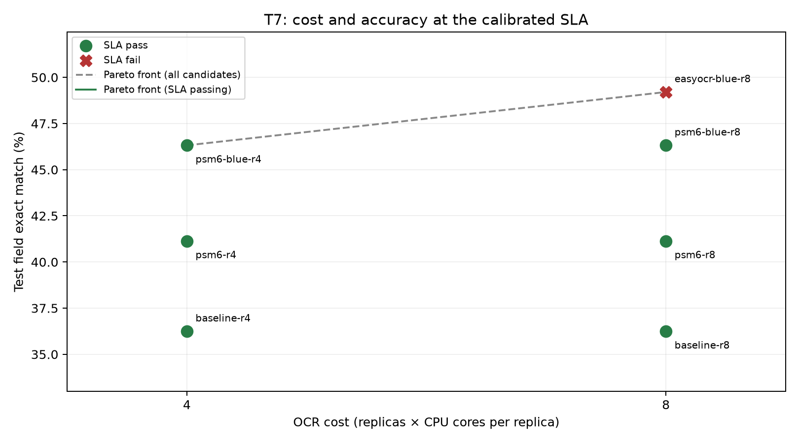
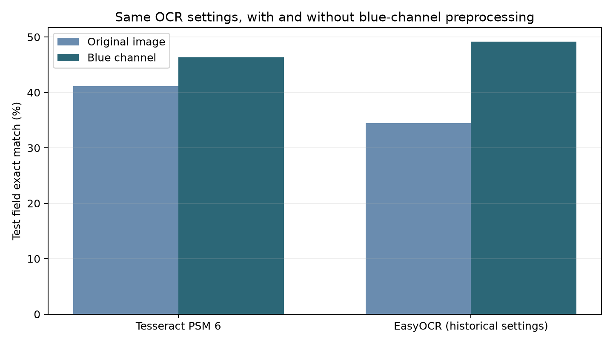

# T7: End-to-end configurations

We compare four main image-to-OCR recipes and six deployments. All use batch 1 and one CPU core per replica.
The additional original-image historical EasyOCR run is an accuracy-only ablation control.
The reference baseline is `tesseract_default` (`chi_sim`, no enhancement, original image), not `original_tesseract`.
Historical EasyOCR preserves its original quantization and reader settings; it is distinct from T6's `easyocr_original`.

## Evaluation

Offline accuracy uses all eight fields on the fixed 2,000-card test slice. Dataset revision: `6a7fd6ba549e99b9a3517fc9a56c4e3377e43e05`;
split seed: 8001. The new blue-channel PSM 6 recipe was checked on the 500-card development slice
before test evaluation. Recipes were fixed before final scoring; no test-set tuning was performed by these scripts.
The service receives only images. Its OCR detections are assigned to annotated boxes by the evaluator after the response.
The live five-field assertion layer and the eight-field offline evaluation are reported separately.

The SLA is p95 <= **1079.253 ms** with target traffic **6 cards/s**.
Matching T6 measurements are reused. Their latency is reported at their actual measured offered rate, not at the target rate.
Only previously unprofiled recipes receive a new target-rate check on the separate load pool (seed 8001, start 0,
15-second warmup and 90-second measurement). SLO attainment includes failed requests in its denominator.
T7 throughput counts completions inside that measurement window; T6 throughput retains the original T6 definition.
Core-seconds are the OCR allocation integrated over the recorded run window.
A blank maximum-throughput or attainment value means that quantity was not measured in the reused source.

## End-to-end configurations

| ID | Cost | Field exact (%) | p95 (ms) | Measured offered rate (cards/s) | SLA |
| --- | --- | --- | --- | --- | --- |
| baseline-r8 | 8 | 36.244 | 1067.529 | 18.000 | pass |
| easyocr-blue-r8 | 8 | 49.206 | 100794.898 | 6.000 | fail |
| psm6-r8 | 8 | 41.137 | 879.986 | 16.500 | pass |
| psm6-blue-r8 | 8 | 46.319 | 417.724 | 6.000 | pass |
| psm6-blue-r4 | 4 | 46.319 | 472.455 | 6.000 | pass |
| baseline-r4 | 4 | 36.244 | 866.911 | 7.500 | pass |
| psm6-r4 | 4 | 41.137 | 1050.953 | 8.250 | pass |

The [full configuration table](t7_configurations.md) also records batch size, replicas, CPU per replica,
card accuracy, CER, assertions, p50/p99, throughput, SLO attainment, core-seconds and the source run.

The dashed front includes all candidates; the green front considers only SLA-passing candidates.
One candidate dominates another when it costs no more and is at least as accurate, with one strict improvement.

## Preprocessing ablation

For ICP, the prescribed stage-contribution experiment compares preprocessing enabled versus disabled with the same OCR settings.
No gold text is substituted for the card image. The two pairs hold model weights, language, resolution,
quantization and recognition settings fixed; only channel selection changes.

| OCR | Original field exact (%) | Blue field exact (%) | Blue minus original (percentage points) | Original mean CER | Blue mean CER |
| --- | --- | --- | --- | --- | --- |
| Tesseract PSM 6 | 41.137 | 46.319 | 5.181 | 0.501 | 0.428 |
| EasyOCR (historical settings) | 34.438 | 49.206 | 14.769 | 0.782 | 0.478 |

On original images the highest field accuracy is **Tesseract PSM 6 (41.14%)**.
On blue-channel images it is **EasyOCR (historical settings) (49.21%)**.
The best downstream OCR choice **changes** between these preprocessing choices
in this selected comparison. If multiple models tie, all are listed.

## Choosing a deployment

**6 of 7 deployments meet the target SLA.** Using a cost-first policy, deploy **psm6-blue-r4**: cost **4 CPU cores**, field exact match **46.32%**. Choose the cheapest qualifying allocation, then the most accurate recipe at that cost. If accuracy takes priority, **psm6-blue-r4** provides **46.32%** at cost **4 cores**.

Optimality depends on the objective and incoming rate. The following choices use the same cost-first policy,
among this report's selected candidates and only at rates supported by their measured results.
For new recipes a passing target-rate check establishes support up to the target; it does not establish a higher maximum.

| Offered rate (cards/s) | Cost-first choice | Cost | Field exact (%) |
| --- | --- | --- | --- |
| 1.500 | psm6-blue-r4 | 4 | 46.319 |
| 6.000 | psm6-blue-r4 | 4 | 46.319 |
| 12.000 | psm6-r8 | 8 | 41.137 |
| 18.000 | baseline-r8 | 8 | 36.244 |

## Reproduction and supporting tables

Run `bash service/run_milestone2.sh --report-only` from the ICP directory to regenerate this report,
the ablation and Pareto plots, the eight-field and assertion tables, the rankings/correlations in `offline/`,
and the existing T5/T6 tables and plots in `t6/`. Raw predictions and performance evidence remain outside this report folder.
